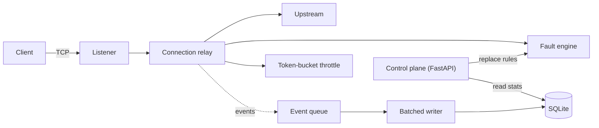
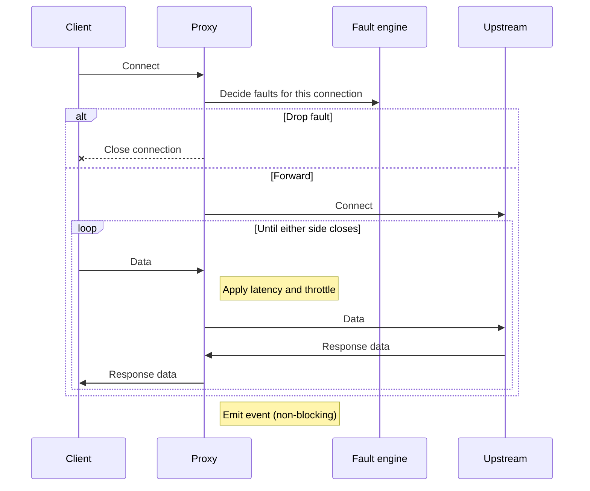

# Architecture

ChaosTap is a single-process network proxy that sits between a client and an upstream server and injects configurable faults: latency, dropped connections, bandwidth limits, and HTTP 5xx responses. Fault rules can be changed at runtime through a small HTTP control plane.

## Scope

**In scope**
- TCP proxying with latency, connection drops, and bandwidth throttling
- HTTP/1.1 proxying with synthetic 5xx responses
- Runtime rule changes through a REST API
- Reproducible runs through a seeded RNG
- Request and connection telemetry stored in SQLite

**Out of scope**
- TLS interception (TLS traffic passes through in `tcp` mode as opaque bytes)
- HTTP/2 and HTTP/3
- Multi-process or distributed deployment

## System overview

The proxy and the control plane run on one `asyncio` event loop, supervised by an `asyncio.TaskGroup`. If either side fails, the whole process shuts down cleanly instead of running half-alive.

## Components

| Component | Package | Responsibility |
|---|---|---|
| Listener and relay | `chaostap.proxy` | Accept clients, connect upstream, relay bytes in both directions |
| HTTP framing | `chaostap.proxy.http1` | Parse HTTP/1.1 (via `h11`) and build synthetic error responses |
| Throttle | `chaostap.proxy.throttle` | Async token-bucket bandwidth limiter |
| Fault engine | `chaostap.faults` | Hold the active profile, match rules, make seeded decisions |
| Control plane | `chaostap.api` | Read and replace the profile, expose live state and stats |
| Telemetry | `chaostap.telemetry` | Queue events, write them to SQLite in batches, serve queries |
| Runtime | `chaostap.runtime` | Wire everything together, handle startup and graceful shutdown |

## Proxy modes

| Mode | Parsing | Supported faults |
|---|---|---|
| `tcp` | None, opaque byte relay | Latency, connection drop, throttle |
| `http` | HTTP/1.1 via `h11` | All of the above, plus synthetic 5xx |

## Connection lifecycle

In `http` mode, a 5xx fault is answered by the proxy itself. The request is not forwarded to the upstream.

## Fault model

A `FaultProfile` is an ordered list of `FaultRule`s, validated with pydantic and loadable from TOML. The first matching rule applies.

| Fault | Modes | Parameters (provisional) | Effect |
|---|---|---|---|
| Latency | tcp, http | `delay_ms`, `jitter_ms` | Delays forwarding by a fixed amount plus random jitter |
| Drop | tcp, http | `probability` | Closes the connection abruptly |
| Error | http | `status`, `probability` | Replies with a synthetic 5xx |
| Throttle | tcp, http | `bytes_per_sec`, `burst_bytes` | Limits throughput per connection |

**Determinism.** Each connection gets its own RNG derived from the run `seed` and the connection's sequence number. Decisions for a given connection therefore do not depend on how other connections interleave, and a run can be replayed from its seed.

**Live updates.** `PUT /v1/faults` validates the new profile and swaps it in atomically. New connections use the new profile; existing connections keep the rules they started with.

## Control plane

| Endpoint | Purpose |
|---|---|
| `GET /health` | Liveness check |
| `GET /v1/faults` | Read the active profile |
| `PUT /v1/faults` | Replace the active profile |
| `POST /v1/faults/reset` | Return to the startup profile |
| `GET /v1/connections` | List live connections |
| `GET /v1/stats` | Counters and latency percentiles |

## Telemetry

The relay only calls `put_nowait` on an `asyncio.Queue`. A single writer task drains the queue and inserts events into SQLite in batches, with WAL mode enabled. The API reads aggregates through a separate repository layer.

If the queue is full, new events are dropped and counted instead of slowing the proxy down. The drop counter is exposed in `/v1/stats`.

## Shutdown

1. Stop accepting new connections.
2. Let in-flight connections finish, up to a timeout.
3. Flush the event queue to SQLite.
4. Close the database and stop the control plane.

## Design decisions

| Decision | Reason |
|---|---|
| Single event loop | Simple concurrency model, no cross-thread locking, enough for a test proxy |
| Pure `asyncio`, no `uvloop` | `uvloop` does not support Windows, and cross-platform is a project goal |
| `h11` for HTTP parsing | Well-tested sans-IO parser, less edge-case risk than a hand-written one |
| Telemetry off the hot path | Keeps proxy overhead independent of database speed |
| Per-connection seeded RNG | Reproducible faults under concurrent load |
| SQLite | Zero setup, one file, sufficient for local test runs |
